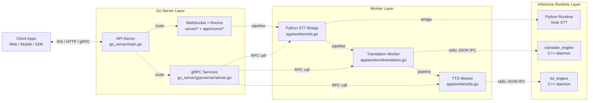

# System Architecture

## Overview

Voice-to-Voice Translator is a low-latency, real-time backend built on:

- Go API server (HTTP + WebSocket + optional gRPC)
- Python STT bridge (Vosk)
- C++ translation and TTS daemons (Sarvam + Svara)

Design goals:

- clear runtime boundaries
- predictable latency for streaming
- modular scaling path from integrated runtime to microservices

## Architecture Comparison

### Current (Integrated Runtime)
```text
+------------------------------------------------------+
| voice-translator-app                                 |
|                                                      |
|  +-----------------------------------------------+   |
|  | Go Server                                      |   |
|  | - HTTP handlers                                |   |
|  | - WebSocket + room routing                     |   |
|  | - Optional gRPC services                       |   |
|  +----------------------+------------------------+   |
|                         |                            |
|  +----------------------v------------------------+   |
|  | Shared Workers                                 |   |
|  | - STT bridge (Python Vosk)                     |   |
|  | - Translation worker (Sarvam daemon)           |   |
|  | - TTS worker (Svara daemon)                    |   |
|  +-----------------------------------------------+   |
+------------------------------------------------------+
```

### Target (Service-Split)
```text
+-------------------+        +----------------------+
| Gateway Service   | gRPC   | STT Service          |
| (HTTP/WS ingress) +------->| (Python Vosk bridge) |
+---------+---------+        +----------------------+
          |
          | gRPC
          v
+----------------------+      +----------------------+
| Translation Service  +----->| TTS Service          |
| (Sarvam daemon)      | gRPC | (Svara daemon)       |
+----------------------+      +----------------------+
```

## High-Level Architecture



Legend:

- Dotted lines (`-.->`) represent routing/invocation boundaries.

## Request Flows

### Real-Time WS Flow
```text
audio chunk -> ws handler -> room router -> STT -> Translation -> TTS -> audio out -> room recipients
```

### gRPC Flow
```text
STT/Translation/TTS RPC -> request validation -> worker call -> runtime engine -> RPC response
```

## Core Components

### 1. Go Server Layer

Purpose:

- entrypoint and orchestration layer

Key files:

- `AI_Pipeline/go_server/main.go`
- `AI_Pipeline/go_server/server/websocket_server.go`
- `AI_Pipeline/go_server/grpcserver/server.go`

Responsibilities:

- HTTP/WS/gRPC routing
- request validation and response shaping
- warm-start and lifecycle of workers

### 2. WebSocket + Room Layer

Purpose:

- real-time session routing between users/rooms

Key files:

- `AI_Pipeline/go_server/server/connection_manager.go`
- `AI_Pipeline/go_server/server/heartbeat.go`
- `AI_Pipeline/app/rooms/manager.go`
- `AI_Pipeline/app/rooms/room.go`
- `AI_Pipeline/app/messaging/router.go`

Responsibilities:

- connection tracking and keepalive
- room membership and dispatch
- translation event routing

### 3. Worker Layer

Purpose:

- isolate model runtime calls from transport/API code

Key files:

- `AI_Pipeline/app/workers/stt.go`
- `AI_Pipeline/app/workers/translation.go`
- `AI_Pipeline/app/workers/tts.go`

Responsibilities:

- STT bridge process execution
- translation daemon lifecycle + resilience controls
- TTS daemon lifecycle + response decoding

### 4. Inference Runtime Layer

STT runtime:

- Python Vosk through `PythonSTTBridge`

Translation runtime:

- `AI_Pipeline/app/pipeline/translate/translate_engine.cpp`
- JSON command protocol over stdio

TTS runtime:

- `AI_Pipeline/app/pipeline/tts/tts_engine.cpp`
- WAV output from daemon/API backend path

### 5. Protocol Layer

Purpose:

- strongly typed contract for service boundaries

Key files:

- `AI_Pipeline/proto/voice_translator.proto`
- `AI_Pipeline/go_server/proto/gen.go`
- `AI_Pipeline/scripts/gen_go_proto.ps1`
- `AI_Pipeline/scripts/gen_go_proto.sh`

Note:

- local Go build requires generated proto files in `AI_Pipeline/go_server/proto/`.

## Data and Control Boundaries

- Go process: API + routing + orchestration
- Python process: STT execution
- C++ processes: Translation and TTS daemons
- IPC: newline-delimited JSON over stdio (worker <-> daemon)

## Deployment Model

### Docker (recommended)

- multi-stage build compiles C++ binaries and Go server
- runtime container launches Go binary
- gRPC toggled via env flags

Relevant files:

- `AI_Pipeline/docker/Dockerfile`
- `AI_Pipeline/docker/docker-compose.yml`

## Configuration Surface

Primary settings file:

- `AI_Pipeline/app/config/settings.go`

Important runtime knobs:

- `HOST`, `PORT`
- `GRPC_ENABLED`, `GRPC_PORT`
- `STT_ENABLE_WARM_START`, `STT_PRELOAD_LANGUAGES`
- `TRANSLATION_ENABLE_WARM_START`, `TRANSLATION_COMMON_PAIRS`
- `TTS_ENABLE_WARM_START`, `TTS_PRELOAD_LANGUAGES`
- `SVARA_TTS_ONNX_MODEL_PATH`, `SVARA_TTS_ONNX_SAMPLE_RATE`

## Scalability Notes

- Horizontal: multiple Go instances behind load balancer
- Vertical: tune daemon workers and queue sizes
- Latency: keep audio shard sizes in low-latency range for streaming paths

## Reliability Notes

- Translation worker has timeout/retry/circuit-breaker behavior
- gRPC health probes runtime worker paths
- Queue and connection limits prevent uncontrolled resource growth

## Extension Points

- add languages by extending scanner/runtime model support
- replace runtime engines by preserving worker contracts
- evolve gRPC/WS contracts through proto + router changes
